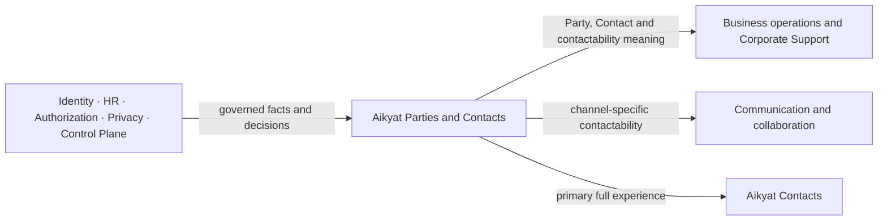

# Aikyat Parties and Contacts — L1 Boundary Map

> **Status: Governing product-side boundary architecture — 2026-10-02.**
>
> This record allocates conceptual responsibility at product boundaries. It does not define APIs, payloads, events, storage, orchestration, or neighbouring products' internal designs.
>
> **Transitional filename:** The filename retains `aikyat-business-core` until repository naming is handled separately.

## Purpose

The [Product Charter](ra-aikyat-business-core.md) establishes Parties, Contacts, and Contactability as one Foundation product. This record explains how that product relates to the rest of Aikyat without transferring authority across product boundaries.

## Conceptual relationship

The diagram shows conceptual dependence, not synchronous calls or implementation topology.

## Adjacent responsibilities

| Adjacent capability | Relationship at this boundary |
|---|---|
| **Business operations and Corporate Support Functions** | Use Parties, Contacts, and contactability while retaining their transactions, accounts, workflows, interpretations, and professional decisions. |
| **Communication and collaboration products** | Use contactability for their channels while retaining transport, conversations, meetings, shared resources, channel behavior, and final interaction enforcement. |
| **Identity** | Supplies authentication and principal meaning; authentication is not business identity. |
| **HR** | Supplies workforce and organization meaning that may influence contactability; it retains workforce relationships, organization structure, positions, assignments, and occupancy. |
| **Authorization and Governance** | Supply cross-cutting policy decisions; Contactability applies them without becoming their semantic owner. |
| **Privacy and purpose-owning domains** | Retain lawful-purpose, consent, retention, erasure, and data-subject responsibilities for the purposes they own. |
| **Control Plane** | Retains workspace membership, product activation, and entitlement. |
| **Foundry** | May discover, propose, compose, and deliver through product-owned boundaries without acquiring product truth. |
| **Other workspaces and federation** | May exchange governed assertions or published references without creating a shared enumerable directory or overriding local acceptance. |

## Universal seam rules

- Every fact or decision retains one semantic owner.
- Supplying an input does not transfer its ownership to Contactability.
- Consuming a Party, Contact, or contactability answer does not transfer product authority to the consumer.
- Neighbours do not write one another's authoritative state directly.
- Contactability governs disclosure at its boundary; the consuming product remains responsible for its eventual action.
- Business relationships and communication routes do not inherently grant access or authority.
- Cross-product seams must preserve workspace sovereignty and provenance.

## Product surface

**Aikyat Contacts** is the broad product experience over Parties, Contacts, and Contactability. Chat, Mail, Meet, and operational products are narrower consumers, not alternate authorities for the same business-contact truth.

This does not make every fact displayed by Aikyat Contacts owned by this product. The application may present governed information from adjacent products while preserving its source and authority.

## Outside this record

Later reviews must define the detailed reciprocal contracts with affected product authorities. This record deliberately does not decide:

- reference or payload shapes;
- calls, events, caches, projections, or consistency mechanics;
- authentication or authorization protocols;
- consent and preference taxonomies;
- availability and failure behavior;
- federation protocols; or
- migration and backward compatibility.

Those questions must not be settled indirectly by extending this L1 map or by adding fields to an existing model.
